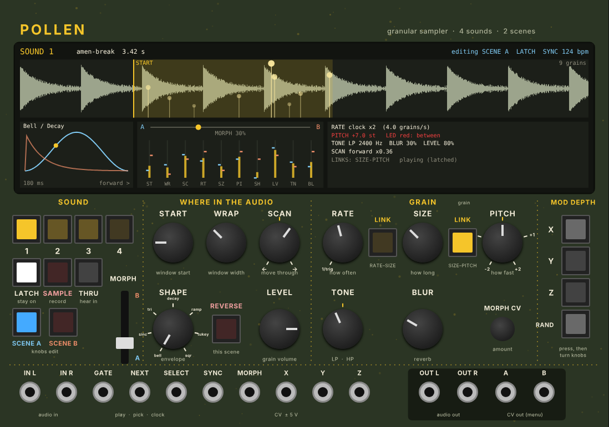

# Pollen

A stereo granular sampler for VCV Rack, made for learning a hardware granular
module away from the case. It has the same ideas as the hardware (Sounds,
two Scenes with a MORPH fader, START / WRAP / SCAN, RATE / SIZE / PITCH,
SHAPE / LEVEL / TONE / BLUR, X / Y / Z / RAND modulation, recording and a live
buffer), laid out more clearly, with a display that shows what is going on.

## Install (Apple Silicon Mac)

1. Open the **Releases** page of this repository and download
   `Pollen-2.0.0-mac-arm64.vcvplugin` from "Latest build".
2. Put it in `~/Library/Application Support/Rack2/plugins-mac-arm64/` and restart Rack.

## Build

Every push builds the plugin on GitHub Actions (see `.github/workflows/build.yml`).
To build locally: `make dist RACK_DIR=/path/to/Rack-SDK`.
Engine tests: `c++ -std=c++11 -O2 -o test/engine_test test/engine_test.cpp && test/engine_test`.
Panel: `pip install fonttools && python3 res/make_panel.py`.
